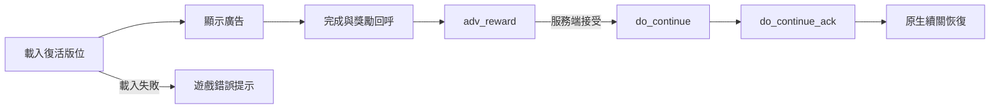

# 廣告復活與通關回傳調查

2026-10-30，唯讀分析 PAD JP 23.6.0／106878，UUID `DD332AD4-4C92-3AAF-85D0-3892556A3A0E`，原始 executable SHA-256 `611c93f5472fceddfa27254b718c6eff1decdc6814cc927e2faa4c7c250a65ec`。沒有發送遊戲 API、修改廣告回呼或實作本機復活。

目前不建議以本機補滿 HP、跳回操作階段代替廣告／魔法石復活。正式流程包括服務端續關交易；本機繼續戰鬥與獲得正式續關並不等價。不能保證通關會接受這種狀態，也沒有證據斷言一定拒絕或觸發某種帳號處置。

## 裝置現象與程式範圍

使用者表示按復活後、廣告尚未開啟便顯示載入／網路錯誤；關卡外獎勵廣告正常，同場關閉功能總開關後仍失敗。這可先定位於載入或其前置流程，尚無 NSError domain／code，不能從通用日文提示判定真是網路訊號、沒有可用廣告或 SDK 狀態。

`PHRuntime.m` 的 `PHDataTask` 只改寫已校驗、主執行緒的 `POST action=save_decks`。其他 action 連同 completion 原樣傳給原始方法；沒有廣告 SDK hook。關閉總開關不會卸載 dylib，也不會撤回同場先前的隊伍變更，因此不能把這項測試當作全新原隊伍／不載入 dylib 的對照。現有資料未證實換隊是載入失敗原因。

## 廣告載入與正式復活

| 原生位置 | 已確認行為 |
|---|---|
| `0x1002209F0` | `loadRewardedAd:` 清除舊廣告及失敗旗標，設 loading，呼叫 `GADRewardedAd` 載入。 |
| `0x100220ACC` | 載入 completion 收到 NSError 時記錄 localizedDescription 並設失敗旗標；成功保存廣告及 delegate，最後清除 loading。 |
| `0x100220DB0`／`0x100220D88` | 分別讀取載入失敗及可否開始另一載入。 |
| `0x100220C08` | `displayAD` 以原本 ViewController 作 presenting controller；展示失败有另一回呼 `0x100220CE0`。 |
| `0x10058118C` | 死亡／續關狀態機：46 載入、48 等待、53 顯示載入失敗；54 才初始化並展示廣告。 |
| `0x1006B3FD0` | 廣告完成後組成 `adv_reward`，包括類型、response ID、廣告 network 與時間。 |
| `0x1006940E8` | 建立 `do_continue`，廣告路徑附 `adv`。 |
| `0x1006A33C4` | 建立 `do_continue_ack`，包含續關交易 `rid` 及可選 `adv`。 |

復活版位使用尾碼 `5075422619`；關外多個入口使用其他版位。因此關外廣告正常不證明復活版位也能載入。SDK 載入失敗可在獎勵／續關請求前出現；這與服務端拒絕 `do_continue` 是不同階段。

狀態 56 取得 response ID／network 後發 request 125、類型 6；狀態 57 檢查回應成功後到 62，設定廣告續關旗標並進入 19 的 request 12；27 發 request 43。`adv_reward` builder 的類型 5 另附地下城／樓層／hash，但本段呼叫為類型 6，不能將類型 5 的參數直接套到復活。

## 通關回傳

`0x1006921C8` 使用 `0x100691748` 解碼靜態請求格式，確認 action 為 `clear_dungeon`。URL 包含玩家／session 識別、戰鬥 hash、地下城、樓層，以及 `tmd`、`nxc`、`c`、`tskip` 等欄位；沒有在 repo 保存任何帳號的實際值。

body 先組成 `ss`、`s`、`e1..e36`、`sm`、`cm`，部分情況附 `pb`，再編碼成 `e`。36 項中可見數值統計、比例／計時、旗標及一致性檢查結果，尚未逐項解明語意。不能聲稱只回傳最後 HP／隊伍，也不能把它說成已證實上傳完整操作重播。

進一步已沿原生寫入者核對換格／技能事件、徽章與計時欄位，另列出尚未確認名稱的統計，見 [通關回傳與狀態一致性](clear-dungeon-audit.md)。`nxc` 和 `e14` 均涉及 audit，`e18` 另檢查持久化隊伍徽章。此分析沒有新增或修改上傳內容。

已知隊伍一致性檢查可累加 audit 旗標，通關 builder 會讀取相同狀態字；細節見 [隊伍替換與結算](monster-replacement.md#為甚麼通關前換回仍不足以證明可結算)。回復本機隊伍或 HP 不代表撤回所有已累積資料。客戶端靜態分析也不能揭示服務端全部驗證規則。

## 建議下一步

優先取得廣告 SDK 載入失敗的 NSError domain／code、版位及載入階段；只記錄診斷，不偽造成功或保存 PID、SID、交易 token。可考慮「重試原生廣告復活」快捷入口，但它仍要經過原版廣告及正式續關，不能承諾避開這次載入錯誤。

若需判斷換隊或注入是否相關，應在全新關卡以原隊伍做對照，再與不載入 dylib 的全新啟動比較；同一場關掉總開關不足以隔離原因。目前先交付已核實的技能與求路修正，廣告錯誤保留為未定位，不新增替代復活功能。
