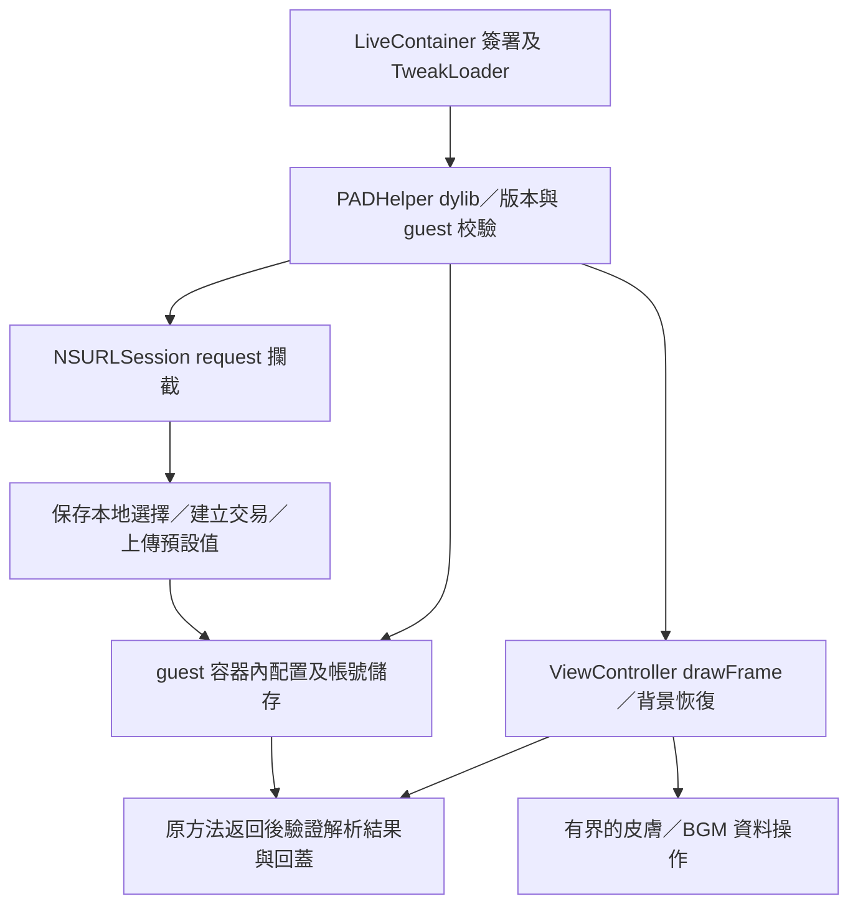

# PADHelper iOS／LiveContainer dylib 可行性與設計

分析日期：2026-10-26。目標環境由使用者提供：iOS 27、自訂 LiveContainer、未啟用 JIT，原版遊戲已能運行。

**結論：可做無 JIT 的 iOS 原型。** 已找到已簽署 dylib 的載入路徑、Objective-C 網路與生命週期攔截點，以及皮膚／BGM 的資料結構。皮膚／BGM、隊伍上傳預設化及背景回前台計時修正有明確實作路線；完整回蓋、多帳號與徽章仍有需要真機驗證的條件。不能把 Android 的 ELF GOT hook、偏移或存檔格式直接搬到 iOS。

本文的位址與結構依 IPA／IDA 靜態分析及 LiveContainer 原始碼核對；下列「已確認」均指這份二進位／原始碼的靜態證據。後續已實作 dylib 並以 GitHub Actions 編譯及檢查 GUI。2026-10-27 使用者回報 `0.2.0-gui` 在 iOS 27、自訂 LiveContainer、無 JIT 下 GUI 及 Skin／BGM 生效；伺服器接受與完整回蓋仍待實測，見 [真機測試記錄](device-testing.md)。

## 1. 功能判定

| Android 功能 | iOS 無 JIT 路線 | 判定與限制 |
|---|---|---|
| 珠子皮膚解鎖 | 修改已驗證的擁有位圖；必要時保留條目其他旗標，只設 bit 0 | 可優先原型；需驗證資源是否已下載、登入後重設時序 |
| BGM 解鎖 | 獨立 BGM 位圖與同一條目表 | 可優先原型；可選取仍取決於音訊檔存在及資源載入 |
| 隊伍上傳預設化 | Objective-C 攔截 NSURLSession，複製 request 後修改 JSON 的指定欄位 | 靜態證據充分；必須同時處理 decksb、decksbs，真機確認伺服器結果 |
| 回應後恢復本地選擇 | 網路交易記錄＋drawFrame 原方法返回後觀察／恢復 | 有可用時序；交易成功、編成改動和隊伍重排需真機核對 |
| 每帳號儲存 | LiveContainer 資料容器隔離，再按已驗證玩家身分分檔 | 容器路徑已確認；穩定帳號識別待驗證 |
| 計時本背景恢復 | restoreFromBackground 原方法返回後，條件式清除已確認的 bit 5 | 基本路徑可行；中斷／棄權旗標與完整 Android 行為尚未等價 |
| 徽章解鎖 | 擁有位圖＋有效參數表兩層判定 | 有條件；填滿位圖不能保證解鎖全部徽章 |

徽章會參與隊伍效果／數值計算，不能將它當作只有外觀的皮膚。Android README 所述「不會封號」沒有由本次 iOS 分析證明；請求預設化只涵蓋已檢查的 save_decks 路徑。

## 2. 精確版本與位址規則

分析輸入：原始 IPA（jp.gungho.pad_23.6.0_decrypted.ipa），解壓的原始 executable 位於 pad（本機分析檔）。

| 項目 | 值 |
|---|---|
| Bundle ID／Executable | jp.gungho.pad／pad |
| CFBundleShortVersionString | 23.6.0 |
| **iOS CFBundleVersion** | **106878**，不能用 Android 的 230600 |
| 架構 | arm64，CPU subtype 0；不是 arm64e |
| 最低系統 | 15.0 |
| LC_UUID | DD332AD4-4C92-3AAF-85D0-3892556A3A0E |
| 原始 executable SHA-256 | 611c93f5472fceddfa27254b718c6eff1decdc6814cc927e2faa4c7c250a65ec |
| 原始 executable 大小 | 21,573,888 bytes |
| 原始 image base | 0x100000000 |
| 加密 | LC_ENCRYPTION_INFO_64 的 cryptid = 0 |

本文的 VA 是 IDA 未套用 ASLR 的位址；RVA = VA − 0x100000000。執行時位置 = **實際 guest Mach-O header + RVA**。檔案 offset 必須由 segment 的 vmaddr／fileoff 轉換，不能一般化為 RVA。

後文使用：

- H：通過 UUID／版本／指令校驗的 guest header。
- S = H + 0x1B517B0：靜態 save／全域物件，**本身就是物件，不能再解參考成指標**。
- G = H + 0x2ABCDF0：靜態 GameMain 物件；其 impl 才是 *(G + 0x70)。

LiveContainer 會修改 Mach-O header、載入命令並重新簽署，因此完整檔案 SHA 僅作原始輸入追溯。執行時用 UUID、Bundle ID、iOS build、數個 __TEXT 指令樣本及結構合理性校驗；不能要求 header 一定仍是 MH_EXECUTE。任何版本或結構不符都停止功能寫入。

機器可讀資料：[pad-23.6.0.json](../targets/pad-23.6.0.json)。

## 3. LiveContainer 已具備的條件

核對的本機原始碼 commit：94eb52a296b13c80bb82fb4515d073294035fc96。這是分析時的 checkout，尚未核對手機實際安裝的 build。

- [TweakLoader.m](https://github.com/hugotang/lc/blob/94eb52a296b13c80bb82fb4515d073294035fc96/TweakLoader/TweakLoader.m#L7)：使用 dlopen(..., RTLD_LAZY | RTLD_GLOBAL) 載入 dylib／framework。LCTweakFolder 指定每個 app 的 tweaks 子資料夾；.disabled 不載入，dontInjectTweakLoader 會停止注入。
- [LCUtilsExtensions.swift](https://github.com/hugotang/lc/blob/94eb52a296b13c80bb82fb4515d073294035fc96/LiveContainerSwiftUI/Utilities/LCUtilsExtensions.swift#L13)：signTweaks 收集 dylib／framework，交給 signFilesWithZSign。**簽署需有可用憑證**；缺憑證時此方法會直接返回，不能只看到「啟動遊戲成功」就認定新 dylib 已簽署。
- [LCAppModel.swift](https://github.com/hugotang/lc/blob/94eb52a296b13c80bb82fb4515d073294035fc96/LiveContainerSwiftUI/Models/LCAppModel.swift#L456)：有 app 專用 tweaks 與全域 tweaks 的簽署流程。載入器遞迴，但此簽署函式只收集該資料夾直接子項；原型 dylib 應直接放在選取的資料夾內。
- [LCMachOUtils.m](https://github.com/hugotang/lc/blob/94eb52a296b13c80bb82fb4515d073294035fc96/LiveContainer/LCMachOUtils.m#L112)：guest executable 轉為 MH_DYLIB，加入 LC_ID_DYLIB 與 TweakLoader 載入命令。此 IPA 的 header 空間約 0x1848 bytes；segment count 與 chained-fixup starts 的 seg_count 都為 5，未見這兩項格式阻礙。
- [LCBootstrap.m](https://github.com/hugotang/lc/blob/94eb52a296b13c80bb82fb4515d073294035fc96/LiveContainer/LCBootstrap.m#L472)：先更換 guest HOME、NSBundle，再載入 guest。
- [Dyld.m](https://github.com/hugotang/lc/blob/94eb52a296b13c80bb82fb4515d073294035fc96/LiveContainer/Tweaks/Dyld.m#L396)：getGuestAppHeader() 可提供真正 guest header；但 dylib 能否 dlsym 到它仍需核對匯出符號。可用時優先使用，否則掃描／觀察載入影像的 UUID，並去除重複 header。不能假設 _dyld_get_image_header(0) 一定是遊戲；LiveContainer 的隱藏模式會轉換索引及名稱。

TweakLoader 載入 CydiaSubstrate，**不等於 MSHookFunction 在此無 JIT 環境可寫原生指令**。初版採已編譯的 Objective-C replacement IMP 與已可寫資料欄位，無需產生可執行記憶體。

## 4. 建議 dylib 結構



| 模組 | 責任 |
|---|---|
| PHBootstrap／PHTarget | 建構子只安排初始化；找到 guest，核對版本、指令和資料結構。避免在 dyld loader lock 內掃大量資料或安裝全部功能 |
| PHObjCHooks | 安裝、保留及呼叫原 IMP；核對方法 encoding 和來源。具體 NSURLSession 實作若繼承方法，先在該 class 加入覆寫，避免意外改到共同 superclass |
| PHSaveView | 用 S、G 與目標描述檔提供有界讀取／寫入；驗證整個記憶體範圍及頁面權限 |
| PHNetwork | 僅對符合 PAD API／action／帳號條件的 request 處理，保存原值，複製 body 並預設化 |
| PHLocalStore | 設定、schema 版本、帳號隔離及原子儲存；只保存選擇欄位和匹配所需的隊伍摘要 |
| PHRestore | 交易與帳號 epoch、解析完成觀察、編成改動防護，避免輪詢把使用者新選擇改回舊值 |
| PHTimer | 原背景恢復方法返回後，確認場景、impl 及 flags 再處理 |
| PHDiagnostics | 記錄載入、校驗、欄位摘要及交易狀態；URL 的 sid／key 和完整登入回應需排除 |

原型預設為診斷模式；先通過身分及資料範圍檢查，再逐項開啟寫入。資料欄位操作與原生遊戲在同一條已確認的執行緒串行進行；先觀察 drawFrame 的實際執行緒，不將「通常在主執行緒」視為已驗證。跨執行緒網路回呼只更新交易狀態。

## 5. 皮膚／BGM：可直接做資料原型

0x10045B0B4（本機證據檔 decomp-10045b0b4.c） 的條件是「擁有位元存在，且條目存在，且 flags == 0 或 flags bit 0 已設」。

| 結構 | 相對 S offset／格式 |
|---|---|
| 條目描述物件 | +0xC77390 |
| 條目 count | +0xC77394，u32 |
| 條目 array | +0xC77398，u64 指標 |
| 字串表 | +0xC773A0，u64 指標 |
| 條目 stride／ID／flags | 0x34／+0x00 u16／+0x0E u16 |
| 皮膚擁有位圖 | +0x5311C8，ID < 10000，以 ID 為 index |
| BGM 擁有位圖 | +0x5312C8，ID >= 10000，以 ID − 10000 為 index |
| 各擁有位圖已確認 span | **0x80 bytes，1024 bits** |
| 皮膚 New／未讀相關欄位 | +0x531248，與擁有位圖分開 |

登入解析 0x10069D1E0（本機證據檔 decomp-10069d1e0.c） 分別清除 8 個 16-byte 值，然後讀 skdr／skbgm；預設皮膚 bits 0、1 及 BGM bit 0。Android 一次寫 0x100 bytes 會包含相鄰 New 區域，iOS 初版只修改已確認的擁有區域。

建議遍歷驗證過的現有條目，而非整段填 0xff：只對該功能的 ID、0 <= bitmapIndex < 1024 設位；flags 為 0 本來就合格，不必改。flags 非 0 且 bit 0 未設時，保留其他 bits 再 OR 1。count×stride 要檢查溢位、合理上限和整段 mapping；空／未載入表時跳過。

0x10045AD60（本機證據檔 decomp-10045ad60.c） 另檢查資源名稱／可用性；0x10021D5C8（本機證據檔 decomp-10021d5c8.c） 經 AVAudioPlayer 載入音訊。解鎖位元不能提供未下載的 BGM。停止功能時，只還原本次已改的位元／旗標；登入覆寫或帳號改變後重新建立快照，不能還原過期的整塊記憶體。

## 6. 網路：iOS 是 JSON，不是 Android 的自訂編碼

靜態路徑：

`0x1006981D0 → 0x1006983F8 → 0x10059068C → 0x100590704 → 0x10045B8E8 → 0x10045B51C → NSURLSession`

0x10045B51C（本機證據檔 decomp-10045b51c.c） 將原生字串複製成 NSData，設定 HTTPBody，再呼叫 sharedSession 的 dataTaskWithRequest:completionHandler:。Content-Type 雖是 application/x-www-form-urlencoded，body 內的隊伍值實際為原始 JSON：

```text
decksb={"fmt":1,"decks":[[...],...]}&decksbs={"fmt":1,"decks":[[...],...]}
```

單隊 serializer 0x1006983F8（本機證據檔 decomp-1006983f8.c） 與 parser 0x10069CC78（本機證據檔 decomp-10069cc78.c） 一致：

| JSON index | 內容 | 預設化 |
|---|---|---|
| 0–4 | 五個卡片 ID | 原樣保留 |
| 5 | 解碼後徽章 ID | badge 功能開啟才改為 0 |
| 6 | 另一個 u32 欄位，語意未定 | 原樣保留 |
| 7 | BGM1 + 100000 × BGM2 | bgm 功能開啟才改為 0 |
| 8 | 珠子皮膚 ID | skin 功能開啟才改為 0 |

例如開啟三項功能時，`[101,102,103,104,105,7,42,100020001,9]` 變成 `[101,102,103,104,105,0,42,0,0]`；42 與卡片 ID 不變。這只是格式示例。

實作流程：

1. 所有 target 校驗成功後，再攔截實際 sharedSession class 的方法；嚴格匹配 POST、精確 action=save_decks、已驗證 API host／path，以及當前帳號。不要以 URL 包含 save_decks 的模糊字串作唯一條件。
2. 校驗 fmt=1、每隊 9 個有界整數及 decksb／decksbs 數量；只替換這兩個參數的 JSON 值，保留未處理的 body 參數原始 bytes。
3. 建立帶帳號 epoch、交易序號、bank／slot 與隊伍摘要的本地快照；原子儲存成功才將修改後 request 交給原 IMP。儲存失敗時停止此功能啟用，避免先丟失選擇再上傳預設值。
4. 使用 mutableCopy，修改 copy 的 HTTPBody 並重設 Content-Length；保持 URL、HTTPMethod、其他 headers 與原 request 不變。沒有改動或不符合條件時直接傳回原路徑。
5. 包裝 completion 時只更新交易狀態，原 completion 恰好呼叫一次，避免改變遊戲的 callback queue 與錯誤語意。

0x100590704（本機證據檔 decomp-100590704.c） 的 key 計算輸入是 URL query，body 另外傳入；這支持只改 body 的路線，**仍需真機確認伺服器接受及是否還有其他資料驗證**。未完整稽核 upload_data、戰鬥／多人請求等其他 action，不能聲稱所有網路途徑都只傳預設值。

特別注意：serializer 會先呼叫徽章判定，不通過就直接輸出 0。所以只從 JSON 保存選擇，可能已經遺失徽章原值；徽章階段需讀取已核對 bank／索引的本地記錄，不能用「body 為 0」覆蓋已保存的原值。

## 7. 回蓋：使用遊戲原本的解析時序

已核對的正常路徑：

`NSURLSession completion 0x10045B778` 複製 NSData → 遊戲 request dispatcher `0x1006BB50C` → `0x100687DB0／0x1005903F0` 解析 JSON → 登入（request ID 33）或 save_decks（122）→ `0x10069C5E0` 寫隊伍。

0x1005903F0（本機證據檔 decomp-1005903f0.c） 把 bytes range 交給 JSON parser；0x100687DB0（本機證據檔 decomp-100687db0.c） 直接查找 res 欄位；0x10069BCFC（本機證據檔 decomp-10069bcfc.c） 從回應取出 decksb／decksbs 物件。這已補上解析格式證據；實際 NSURLSession 回應仍需確認 gzip 處理、大小及錯誤形狀。

ViewController drawFrame（本機證據檔 decomp-10021e808.c） 經：

`0x1004EC5F0 → 0x1005747F8 → 0x100573D3C → 0x100591470 → 0x1006BB50C`

執行正常網路解析後返回。Metal 的 drawInMTKView: 也呼叫 drawFrame。可在原 drawFrame 返回後觀察已更新記錄，下一次遊戲循環前恢復需要的欄位。這提供無 JIT 路線；不能在 NSURLSession completion 返回時假設原生解析已結束。

建議狀態機為 `已保存 → 已提交 → 網路完成 → 已觀察解析成功 → 已回蓋`：

- HTTP 200 不是遊戲業務成功；需驗證 res、當前 native request／錯誤狀態與相同交易，超時／錯誤就結束交易且不以失敗回應刷新本地快照。
- 初版在 frame hook 只觀察 pending 交易；正常 frame 走常數成本的停用／無交易分支，避免每 frame 全盤掃描或寫檔。
- 回蓋前比對帳號 epoch、bank、slot、卡片摘要及解析後的預設值；只恢復已啟用欄位。不要無限重寫，使使用者無法改回 0。
- 帳號切換、隊伍增刪／重排、重複同隊與登入回應會改變 mapping；無法一一匹配時先停止回蓋。不能只靠「非零保留、零回蓋」判定來源。
- 登入解析會重設擁有位圖，需在解析後重新套用已啟用功能。登入後穩定帳號 ID 與解析成功觀察仍列為真機驗收項。
- 若 frame 後恢復仍來不及讓某個同 frame UI／數值快取重建，需找到額外可用的資料 callback 或靜態方案；不能僅靠增加輪詢頻率宣稱等價。

## 8. 隊伍記憶體與帳號儲存

| 結構 | 位址／格式 |
|---|---|
| 主要 persisted records | S+0x52F394，stride 0x60，配置容量 32 |
| 次要 persisted records | S+0x52FFAC，stride 0x60，配置容量 16 |
| 隊伍上限 | S+0x52F384，u16；解析器會限制至 32 |
| 主要隊伍數 | S+0x52F38F，u8 |
| 次要隊伍數 | S+0x52F38E，u8 |
| persisted BGM1／BGM2／skin | record+0x18／+0x1A／+0x1C，均 u16 |
| persisted badge | record+0x5F，u8；raw XOR ((15×i+0x61) & 0xff) |
| editing 結構 | S+0x5305AC；已觀察記錄 header +8，badge 相對結構為 +0x67；完整 bank 對照尚待驗證 |
| request records | *(q+0x20)+0x0C+i×0x60；相對 request array 的 BGM1／BGM2／skin／badge 為 +0x24／+0x26／+0x28／+0x6B |

容量不等於有效隊伍數；不能把主要 32 與次要 16 相加當成可上傳 48 隊。次要 parser 的徽章 XOR 使用該 bank 的局部 i，而 serializer 的 request array 可能使用合併索引，移動／恢復時須重新編碼。skin 在 iOS 是 u16，不能套用 Android 部分程式中的 byte 寫法。

推薦儲存目錄：`NSHomeDirectory()/Library/Application Support/PADHelper`。這會隨 guest 容器隔離；同一容器內切帳號，仍須再分帳號。save_decks 的 pid 取自 S+0x83D50 的 u32，可作候選身分，但需用登入／切帳號實測確認有效性及更新時序，並排除未登入的 0／過期值。

iOS 有 data048.bin 讀寫：0x1004438F8（本機證據檔 decomp-1004438f8.c）、0x1004439C8（本機證據檔 decomp-1004439c8.c）。實際 iOS 路徑未定位；不可使用 Android 的 files/data048.bin。對整個憑證檔取 FNV 哈希是否穩定也未驗證，不能直接作帳號主鍵。

自有格式保存解碼後 ID、功能 mask、bank／slot、schema 版本及匹配摘要；不複製整份 0x60 原始記錄作為還原來源，不直接改寫遊戲加密存檔。

## 9. 徽章：第二階段

0x100453CF4（本機證據檔 decomp-100453cf4.c） 先拒絕 ID 0，要求 0x10056CA88（本機證據檔 decomp-10056ca88.c） 取得非零參數，再檢查 8 個 u32 的擁有位圖：

- 玩家物件 S+0x83D50；相對玩家 +0x4AB5C4，亦即 S+0x52F314。
- decodedWord = rawWord XOR 0x9A69F65A；全 1 的 raw 值會是 0x659609A5。
- 參數表指標在 S+0xA0，stride 0xB4，有 prerequisite ID 及多個相依數值。
- 0x10056C3B8（本機證據檔 decomp-10056c3b8.c） 使用 XOR／rotate 和相關值核對。不能直接填參數表來保證有效。
- hasBadge／參數查詢的已觀察 xrefs 是直接 BL／B；未找到可直接套用 Android GOT 位址的匯入指標。

初版應先列出有效徽章 ID、參數返回值、先決條件和 ownership，再只嘗試已驗證有效且在 256-bit 範圍內的 ID。若完整解鎖確實需要改原生判定，備選是**簽署之前**對精確 IPA 做靜態改寫／dispatch 設計；這是另一個版本適配專案，目前未實作，也不以啟用 JIT 作前提。

## 10. 計時本背景恢復

0x1005B8C14（本機證據檔 decomp-1005b8c14.c） 在 resume 時對 *(G+0x70)+0xAFEF0 設 bit 5（0x20）。計時畫面 0x1004A3580（本機證據檔 decomp-1004a3580.c） 檢查 0x22 時顯示 ---.--；其他兩條畫面路徑還有額外條件。

Objective-C 路徑是 AppDelegate.applicationWillEnterForeground: → ViewController.restoreFromBackground（本機證據檔 decomp-10021e6c0.c） → 原生 resume。在原方法返回後：

1. 確認 S 的 current／requested scene 一致且為 GameMain（scene table index 1），場景物件為 G。
2. 確認 impl 指標、flags 位址與可寫範圍有效，且確定處於受影響的計時情境。
3. 條件式清除 bit 5，保留所有其他 bits；實測畫面與實際倒數都恢復。

Android 還會處理 bit 1／bit 6，iOS 不照搬。清除 0x20 無法排除 0x02 或其他條件造成的 ---.--；棄權、續關、強制退出和倒數是否計入背景時間需另外驗證。

GameMain resume 的 vtable slot 0x10114B880 指向 0x1005B8C14，但位於 __DATA_CONST；初版不需改 vtable，也不假設該頁一直可寫。

## 11. 建置、載入與驗收順序

建置目標：arm64 iPhoneOS dylib，Objective-C／必要時 Objective-C++，使用 Foundation、UIKit 與 libobjc。replacement IMP 都預先編譯，避免 JIT、可執行 trampoline 或 __TEXT 寫入。Windows 本機無 Xcode 工具鏈；本 repo 的 GitHub Actions 已使用 macOS／Xcode 產出 dylib。

建置後將 dylib 直接放在 PAD 的 LCTweakFolder 所選資料夾，由可用憑證簽署並確認載入日誌。iOS 27 下「遊戲本身可運行」只證明既有 guest 路徑可用，新 dylib 的簽署／dlopen 仍要驗證。

| 階段 | 驗收條件 |
|---|---|
| 0：空白／診斷 dylib | 無 JIT 可簽署載入，constructor 日誌、UUID、build 正確 |
| 1：唯讀 probe | S 是靜態物件、count／array／deck 範圍合理、frame 執行緒與帳號更新時序確認 |
| 2：個別皮膚／BGM | 各開關只影響自身；資源存在；登入重設後仍可重新套用；關閉可還原 |
| 3：請求複製及本地儲存 | 單項／組合模式只改指定 JSON 欄位，decksb／decksbs 都正確，伺服器業務成功 |
| 4：回蓋與交易 | 登入、正常儲存、超時／重試、修改回 0、隊伍重排與重複隊伍不丟選擇 |
| 5：帳號／容器 | A→B→A、同帳號重啟、不同 LC 容器，不串資料；未識別帳號不寫入 |
| 6：計時 | 前後台往返、長背景、對話框及非計時場景，驗證真正倒數與狀態 |
| 7：徽章 | 參數、擁有、編成／戰鬥效果及上傳來源分別確認 |

**推薦實作次序：診斷及版本鎖 → 皮膚／BGM＋上傳及回蓋成套完成 → 帳號隔離 → 基本計時修正 → 徽章。** 啟用本地解鎖前，先確保選擇儲存和已涉及的上傳路徑能一起工作。

## 12. 可追溯分析產物

- Mach-O metadata（本機證據檔 macho-metadata.json） 與 IDA database（本機證據檔 pad.i64）。
- 網路分析（本機證據檔 ida-query-network.json）、位圖／BGM（本機證據檔 ida-query-bgm.json）、計時／徽章（本機證據檔 ida-query-timer-badge.json）。
- 回應解析（本機證據檔 ida-query-delivery.json）、dispatch（本機證據檔 ida-query-dispatch.json）、frame（本機證據檔 ida-query-frame.json）、frame path（本機證據檔 ida-query-frame-path.json）、frame final（本機證據檔 ida-query-frame-final.json）。
- 使用本機 IDA Professional 9.4 的 headless IDAPython 匯出 decompile／disasm／xrefs。IDA MCP 開庫失敗後改用既有 IDA CLI，未更改使用者外掛配置。
- 原始 IPA、executable、IDA database 與反編譯匯出保留在分析資料夾；專案只新增設計文件及目標描述檔。
