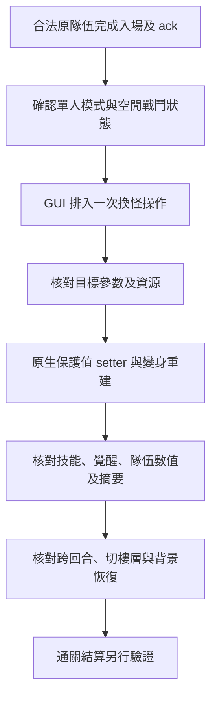

# 地下城內替換未持有怪物：可行性分析

日期：2026-10-27。延續使用者「在編譯之前探討修改隊伍為沒有持有的怪物」的要求。

目標：日服 PAD 23.6.0／iOS build 106878，原始 Mach-O UUID `DD332AD4-4C92-3AAF-85D0-3892556A3A0E`。環境沿用 iOS 27、自訂 LiveContainer、無 JIT；GUI 與 Skin／BGM 已由使用者回報生效。後續依「動手」要求加入 `0.3.0-battle` 單名队員替換原型；隊員替換仍未真機驗證。

**結論：在單人戰鬥中暫時使用未持有怪物，有明確的無 JIT 原型路線；通關後能否正常結算仍未證明。** 最有根據的做法是保留原本合法隊伍，利用遊戲自己的戰鬥變身資料及重建流程。它不能由現有 Skin／BGM 的 save_decks 預設化直接推論可用，也不能保證「通關前換回原隊」就能通過驗證。

| 目標 | 判定 | 原因 |
|---|---|---|
| 編成頁直接填未持有怪物 | 不適合現有原型 | 編成記錄引用帳號持有卡片的識別碼；圖鑑編號是另一個欄位 |
| 合法隊伍入場後，暫時改戰鬥中的角色 | 可做受限原型 | 戰鬥物件獨立，已有原生變身欄位、參數重建及隊伍刷新鏈 |
| 任意設定等級、繼承、潛覺與所有衍生形態 | 另需擴展 | 普通變身會沿用／調整原隊員部分資料，不能視為完整新建一張持有卡片 |
| 以替換隊伍取得伺服器承認的通關結果 | 未確認 | 通關上傳包含入場 hash、36 個統計／狀態欄位和完整性相關旗標 |

## 入場使用甚麼資料

[0x100006318](E:/ipa/analysis/pad_23.6.0/decomp-100006318.c) 從目前隊伍的 `0x60` 記錄取出卡片識別碼；[0x100530448](E:/ipa/analysis/pad_23.6.0/decomp-100530448.c) 再到帳號的持有卡片集合中查找該識別碼。後者的記錄 stride 是 `0x48`，識別碼位於記錄 `+0x08`，怪物圖鑑編號位於 `+0x10`。

因此把例如「圖鑑編號 N」直接寫入編成的卡片識別碼，程式會把 N 當作持有卡片識別碼查找。[0x10036828C](E:/ipa/analysis/pad_23.6.0/decomp-10036828c.c) 還會刪除找不到持有記錄的編成卡片，並記錄 `invalid deck ... card ... deleted`。

[入場建構函式 0x100690E44](E:/ipa/analysis/pad_23.6.0/decomp-100690e44.c) 發送 `sneak_dungeon`，其中包括：

- `curdeck`：所選隊伍。
- `lc`：首個編成卡片識別碼。
- `ds`：由持有卡片資料取得的怪物編號與繼承資料，以及 helper 資料。
- `pc`：五名自有隊員的持有卡片識別碼。

這證明入場請求帶有隊伍身分資料；伺服器實際如何驗證屬於未取得的服務端邏輯。原型應維持合法隊伍完成入場與 ack，之後才處理戰鬥物件。

## 已找到的本地換怪路線

設 `H` 為通過版本／UUID／指令校驗的 guest header，`S = H + 0x1B517B0`，`G = H + 0x2ABCDF0`，`B = *(G + 0x70)`。以下是未套用 ASLR 的這一版結構，不能直接用作其他版本。

| 戰鬥資料 | 位置／格式 | 靜態用途 |
|---|---|---|
| 目前戰鬥隊員 | `M[i] = B + 0xB11F0 + i × 0x5F0`，六個 slot | 目前作用中的隊員物件；多人／其他 bank 另有路徑 |
| 原編成 slot | `M+0xB8`，16-byte 保護值，解碼為 signed byte | 用原合法 slot 找到持有卡片資料 |
| 暫時變身編號 | `M+0xF8`，16-byte 保護值 | 在暫時變身狀態有效時覆寫角色 |
| 暫時變身狀態／回合 | `M+0x108`，16-byte 保護值 | 原生回合流程會更新，不能當成普通布林值 |
| 持續變身編號 | `M+0x118`，16-byte 保護值，讀取為 u16 | 普通變身技能使用的候選入口 |
| 關卡 param slot | `M+0x128`，16-byte 保護值，解碼為 signed byte | 指向關卡指定隊員參數 |
| 衍生 CardParam | `M+0x4E0` | 原生程式重建參數／技能等資料 |
| CardParam 目前編號 | `M+0x50C`，u32 | 用於觀察實際生成的角色，與來源編號分別核對 |
| 來源編號／繼承編號 | `M+0x5B0`／`M+0x5B2`，u16 | 重建過程先記錄的來源資訊，不等同變身後的所有資料 |

### 優先：沿用普通變身流程

[原生技能 dispatcher 0x1005C5DF0 的 case 236](E:/ipa/analysis/pad_23.6.0/decomp-1005c5df0.c:2688) 從技能參數選擇目標怪物，檢查編號有效後，將其寫入 `M+0x118`，再重建隊員、調整技能冷卻並刷新隊伍資料。這個分支沒有查詢帳號是否持有目標怪物。

[0x100531EEC](E:/ipa/analysis/pad_23.6.0/decomp-100531eec.c) 是編號範圍／保留值判定；[0x10052FC4C](E:/ipa/analysis/pad_23.6.0/decomp-10052fc4c.c) 查怪物參數表，普通記錄 stride 為 `0x348`。這支持「合法原隊員作為來源，戰鬥中使用另一隻參數表已存在的怪物」的設計。

[0x1005A12F0](E:/ipa/analysis/pad_23.6.0/decomp-1005a12f0.c:311) 會讀取變身欄位，以目標參數調整技能／覺醒資料，再重建 CardParam。[0x10053758C](E:/ipa/analysis/pad_23.6.0/decomp-10053758c.c) 也會核對目標技能、覺醒數量及部分相依資料。僅修改顯示編號，無法取得這套行為。

建議初版只接受普通、有效、可由 u16 表示的圖鑑編號，並沿用明確的來源等級／繼承政策。保留編號 `9900..9999`、特殊值 `10000000`、多層編碼形態、缺少參數或資源的角色，需要另行處理。圖片、技能演出及聲音是否已下載，也須驗證。

### 備選：關卡指定隊員參數

[0x10059A848](E:/ipa/analysis/pad_23.6.0/decomp-10059a848.c:52) 解析關卡腳本的 `param`／`assist`／`ifwave`／`set` 命令。參數槽位是 `0x2C` 記錄，可指定怪物編號、等級、技能、覺醒及繼承；這說明引擎有獨立於持有卡片集合的指定隊員機制。

`0x1005A12F0` 在 `S+0xF66E40` 指標非零、`M+0x128` 有有效槽位時，使用 `S+0xF6AE80` 的指定隊員表覆寫來源資料。它可以作為特定關卡下的第二條原型路線，但一般地下城是否啟用這套腳本環境仍須觀察。相關指標也被腳本執行流程使用，不能僅填一個非零值來通過條件。

## 無 JIT 與重建要求

目前 dylib 已有 `ViewController.drawFrame` 的 Objective-C IMP 攔截與 guest 校驗。新功能可以把 GUI 操作排入佇列，在已確認的遊戲執行緒、單人戰鬥且空閒的時機執行。呼叫遊戲已簽署的原生函式不需要 JIT；這與修改原生 `__TEXT` 或建立可執行 trampoline 是不同操作。

重要的原生資料流程：

| 函式 | 用途／限制 |
|---|---|
| `0x100570DD8`／`0x100570E50` | 保護值的 signed-byte getter／setter，儲存結構為 16 bytes |
| `0x100571040`／`0x10056C990` | 前者解碼為 u16；後者更新同類保護結構，還會更新全域隨機狀態 |
| `0x1005A12F0` | 重建單名隊員；C++ 型別／參數及執行時機需要驗證 |
| `0x1005A2990` | 重建作用中的隊員、呼叫隊伍刷新，更新隊員資料摘要 |
| `0x10006F798` | 隊伍數值刷新鏈；依模式分流，不能只因處於 GameMain 就假設是單人 |
| `0x1005A2B38` | 由隊員的衍生資料與技能資料計算摘要 |

直接寫 `M+0x118` 的兩個 bytes 會破壞其保護結構。實作應在遊戲執行緒使用已核對的原生 setter，並依普通變身的完整刷新順序處理冷卻、隊伍數值及摘要。不是每個上述函式都可不分時機直接呼叫；需為新增呼叫各自校驗指令樣本、ABI、整段資料範圍及重入條件。

回復時應保存「本次修改欄位的解碼值」，使用當前有效物件及原生流程重建。整個 `0x5F0` 隊員含資源／參數指標和動態狀態，不應整塊 memcpy 回復舊快照。

## 為甚麼通關前換回仍不足以證明可結算

[0x1006921C8](E:/ipa/analysis/pad_23.6.0/decomp-1006921c8.c:395) 使用 `0x100691748` 解碼請求格式，已從 IDA 匯出的原始 bytes 還原為：

```text
clear_dungeon&pid=%d&sid=%s&hash=%s&tmd=%d&nxc=%8x&dung=%d&floor=%d&v=2&c=%d%s&tskip=%d
```

它還建立 `ss`、`s`、`e1..e36`、`sm`、`cm`，部分情況帶 `pb`，再編碼成 HTTP body 的 `e`。這證明通關資料超過最後的隊伍選擇；尚未逐一確認 36 個欄位的語意，也沒有服務端驗證程式或完整戰鬥重播上傳的證據。

更直接的證據是 [0x1005B4BF4](E:/ipa/analysis/pad_23.6.0/decomp-1005b4bf4.c:59)：它把目前隊員摘要與保存的摘要比較，不符就把 `S+0x5CA0BC` 的 `0x10000` 設上；其他數值不一致也會記錄旗標。這個函式以 OR 累加異常，不在恢復正常的分支清除它。

`0x1006921C8` 會讀取同一個狀態字，將其編入通關欄位。所以「先改錯，最後只換回角色 ID」不會自動撤回已記錄的異常或改變已累積的戰鬥統計。原型須維持引擎自身的資料一致性；即使本地檢查一致，也只能證明本地執行條件，仍不能推論服務端會接受與原入場隊伍不同的戰鬥效果。

`logb2` 則出現在 [0x10068B540 的伺服器回應解析](E:/ipa/analysis/pad_23.6.0/decomp-10068b540.c:325)。此次分析沒有把它當作已證明的完整戰鬥重播格式。

## 建議原型範圍與驗收



第一階段做唯讀 probe：顯示作用中 slot、來源／目前怪物編號、變身欄位、param 環境、隊伍摘要是否一致及目前操作是否可用。先確認單人模式的實際判定，不以 GameMain 場景作唯一條件。

第二階段只替換一名已有合法來源的隊員，目標限制為普通有效編號；不改帳號持有卡片集合、編成卡片識別碼或伺服器隊伍。一次操作後驗證：

1. 圖像與目前 CardParam 編號相符，實際技能及冷卻屬於目標角色。
2. 覺醒、隊長技、繼承／潛覺相依行為及隊伍總數值符合既定來源政策。
3. 下一回合、切樓層、隊長交換、原角色再次變身後，功能不意外回退或覆蓋遊戲新狀態。
4. 原生資料摘要保持一致；操作不增加已辨識的本地異常旗標。
5. 切後台、死亡／續關、離開、重開程序與地下城恢復各自有確定處理。
6. 還原後來源與衍生資料一致；原合法編成記錄保持正確。

第三階段才評估通關：確認哪些統計受到替換影響、其與入場 hash／隊伍資料的關係，以及業務回應與獎勵是否成功。連續幾次成功也不能證明所有地下城、角色、排行或服務端檢查分支皆等價。

本報告先完成靜態分析；後續依使用者「動手」要求加入 GUI 與原型。`PHBattleNative.mm` 採用 case 236 的單名重建與 `0x10006F798(game, 0)` 刷新順序，避免重建所有隊員。新增原生呼叫均有獨立 64-byte 指令校驗；CI 能檢查編譯、狀態機與 GUI，真機遊戲效果及結算仍須按上述項目驗收。

## 分析產物

- [此次證據摘要](E:/ipa/analysis/pad_23.6.0/monster-feasibility-summary.json)。
- [原始 IPA metadata](E:/ipa/analysis/pad_23.6.0/macho-metadata.json)；原始 executable SHA-256 `611c93f5472fceddfa27254b718c6eff1decdc6814cc927e2faa4c7c250a65ec`。
- 前次留下的 `ida-monster-network-first.json`、`ida-monster-api-strings.json`、`ida-monster-finish-strings.json`、`ida-monster-battle-and-result.json`，均位於 `E:/ipa/analysis/pad_23.6.0`。
- 此次補查：[ida-monster-followup.json](E:/ipa/analysis/pad_23.6.0/ida-monster-followup.json) 及 [ida-monster-followup-checks.json](E:/ipa/analysis/pad_23.6.0/ida-monster-followup-checks.json)。使用現有 IDA Professional 9.4 命令列讀取既有資料庫，匯出反編譯、指令與 xrefs；未修改遊戲指令。
- 可重跑的 [IDA exporter wrapper](E:/ipa/analysis/pad_23.6.0/ida_monster_followup.py)；使用 `query-monster-followup.json` 或 `query-monster-checks.json`。所有新隊員功能的 `runtime_verified` 均為 false。
